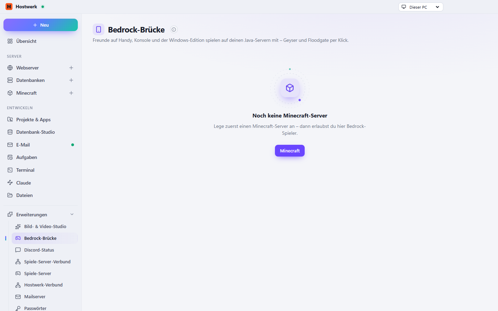

# Bedrock-Brücke

> **Abgelöst durch [Minecraft-Servernetzwerk](https://github.com/Passimoritz/hostwerk-ext-mc-network).** In einem Netzwerk gehört Geyser auf den Proxy – einmal für alle Server. Die neue Erweiterung macht das, bringt Bedrock Dedicated Server, Versions-Brücken und Netzwerke mit und übernimmt alles aus dieser Erweiterung ohne Verlust. Version 1.2.0 bietet den Umzug an und tritt zur Seite, sobald der Nachfolger installiert ist.

Freunde am Handy, an der Konsole und mit der Windows-Edition spielen auf deinen Java-Servern: Geyser und Floodgate mit einem Klick.

[English](README.md) · Offizielle [Hostwerk](https://github.com/Passimoritz/hostwerk-public)-Erweiterung (SDK 2.7, native Erweiterung)



## Was sie kann

- Geyser und Floodgate mit einem Klick – auch hinter Velocity (Floodgate und Schlüssel auf allen Servern im Netzwerk)
- Eigener UDP-Port (prüft, was auf dem PC schon belegt ist) und Router-Freigabe
- Adressen für zu Hause und für Freunde draußen, Anleitung für Handy, Windows und Konsolen
- Serverlisten-Eintrag für Bedrock (MOTD, Servername), GeyserOptionalPack per Schalter
- Automatische Updates, sobald niemand online ist; Ausschalten räumt alles auf
- „Bedrock“ an jedem Minecraft-Server und eine eigene Seite

Andere Erweiterungen erkennen Bedrock-Spieler über `prefix`/`bedrockPlayers` in `GET /api/mc/servers/<id>/bedrock` oder den Dienst `bedrock` (`isBedrock(server, name)`).

## Installieren

In Hostwerk unter **Erweiterungen → Entdecken** auf „Installieren“ klicken. Wer die Funktion schon in Hostwerk 2.8 benutzt hat, bekommt die Erweiterung beim Update automatisch – mit allen Daten.

Native Erweiterungen laufen als Teil von Hostwerk (eigener Server- und Oberflächen-Teil). Darum installiert Hostwerk sie nur aus dem offiziellen Katalog (mit Prüfsumme) oder im Entwickler-Modus.

## Daten

`settings.minecraft.servers[].geyser` – genau dort, wo Hostwerk sie schon immer abgelegt hat. Entfernen der Erweiterung löscht nichts.

## Entwickeln

```bash
node --test tests/*.test.js          # Tests
node build-native.js .               # Oberfläche bauen (sdk/build-native.js aus hostwerk-public)
node check.js . --strict             # Prüfung wie im Katalog (sdk/check.js)
```

Quelltext der Oberfläche in `ui/src`, Server-Teil in `server/`. Texte im Code sind Englisch, Deutsch steht in `locales/de.json`.

## Lizenz

MIT
