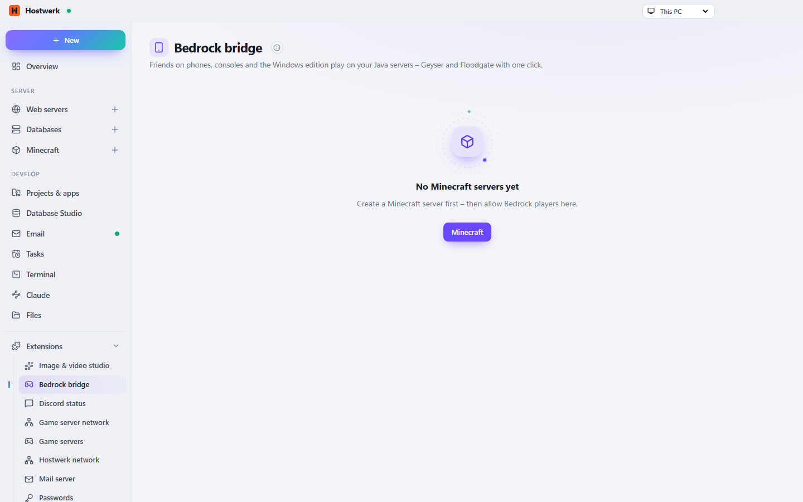

# Bedrock bridge

Friends on phones, consoles and the Windows edition play on your Java servers: Geyser and Floodgate with one click.

[Deutsch](README.de.md) · An official [Hostwerk](https://github.com/Passimoritz/hostwerk-public) extension (SDK 2.7, native extension)



## What it does

- Geyser and Floodgate with one click – also behind Velocity (Floodgate and the key on every server of the network)
- Own UDP port (checks what is already taken on this PC) and router forwarding
- Addresses for home and for friends outside, guide for phones, Windows and consoles
- Bedrock server list entry (MOTD, server name), GeyserOptionalPack with one switch
- Automatic updates as soon as nobody is online; switching off cleans everything up
- “Bedrock” on every Minecraft server and its own page

Other extensions recognise Bedrock players through `prefix`/`bedrockPlayers` in `GET /api/mc/servers/<id>/bedrock` or the service `bedrock` (`isBedrock(server, name)`).

## Install

In Hostwerk: **Extensions → Discover** and click “Install”. If you already used this feature in Hostwerk 2.8, the update installs the extension by itself – with all your data.

Native extensions run as part of Hostwerk (own server and interface part). That is why Hostwerk only installs them from the official catalogue (with checksum) or in developer mode.

## Data

`settings.minecraft.servers[].geyser` – exactly where Hostwerk always kept it. Removing the extension deletes nothing.

## Develop

```bash
node --test tests/*.test.js          # tests
node build-native.js .               # build the interface (sdk/build-native.js from hostwerk-public)
node check.js . --strict             # same check as the catalogue (sdk/check.js)
```

Interface source in `ui/src`, server part in `server/`. Texts in the code are English, German is in `locales/de.json`.

## License

MIT
